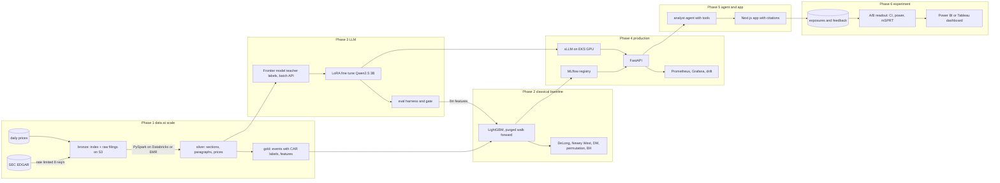

# Filings Intelligence Lab

Can the language in a company's SEC filings predict its stock's reaction? The lab answers that three ways,
in one system built in six phases: a classical model with honest statistics, a fine tuned small LLM that
extracts structured signals, and an analyst agent that answers questions with citations to the exact
filing paragraph. Everything runs end to end on a laptop against a synthetic EDGAR shaped world, and the
same code points at real EDGAR, S3, Databricks or EMR, EKS and a GPU for production scale.


## Architecture



## Phases

| Phase | What is built | Where | Doc |
|---|---|---|---|
| 1 Data at scale | Rate limited EDGAR client, bulk and API index builders, price and XBRL ingestion commands, HTML and inline XBRL cleaning, TOC aware section extraction, stable paragraph ids, acceptance time event alignment with informational and tradable CARs, PySpark jobs for the lake and the features (both proven equal to the local build), 22 data quality gates with a leakage canary, Databricks bundle, EMR steps, Terraform, DuckDB SQL | `pipeline/`, `edgar/`, `text/`, `prices/`, `infra/` | [phase1](docs/phases/phase1_data.md) |
| 2 Classical baseline and statistics | Lexicon, change, rule and point in time XBRL features; purged walk forward LightGBM with purged k fold tuning; DeLong, Newey West, bootstrap, Diebold Mariano, permutation and Benjamini Hochberg tests; calibration; a cost aware tradable backtest; ablations and SHAP | `features/`, `modeling/`, `sql/` | [phase2](docs/phases/phase2_baseline.md) |
| 3 Fine tune an LLM | Strict signal schema, evidence selection, frontier model teacher with structured outputs and batch labelling, human review with Cohen's kappa, TRL and PEFT LoRA or QLoRA trainer, a small model pretrained from scratch and fine tuned end to end on CPU (format learned, content not: the gate keeps the rules), eval harness with grounding checks, gold set fingerprints and a regression gate, adapters registered in MLflow with lineage | `llm/`, `configs/` | [phase3](docs/phases/phase3_llm.md) |
| 4 Serve it in production | FastAPI with circuit breaker, fallback and per quote grounding, vLLM with multi LoRA (and an OpenAI compatible CPU stand in that served the fine tuned adapters here), MLflow tracking and alias registry, live and batch drift with retrain recommendations, Prometheus with unit tested alerts and Grafana, hardened containers verified as the cluster runs them, Kubernetes with HPA, KEDA and CronJobs, EKS Terraform with least privilege roles, load test, CI gate with GitOps promotion | `serving/`, `infra/k8s`, `infra/eks`, `loadtest/`, `.github/` | [phase4](docs/phases/phase4_serving.md) |
| 5 Analyst agent and app | Tools for search, paragraphs, filings, prices, event returns, live extraction and model signals; LLM tool loop with verified citations; offline mode; Next.js and TypeScript app with filing viewer, experiment page and review page | `agent/`, `web/` | [phase5](docs/phases/phase5_agent.md) |
| 6 Experiment and dashboard | Sticky assignment with a model version per variant, per replica event logs merged from S3 with signed request ids, power analysis, readout with clustered intervals, SRM check, mSPRT with confidence sequences and a maximum sample, guardrails and a treatment integrity check; BI star schema, DAX and Tableau kits; published dashboard | `experiment/`, `dashboards/` | [phase6](docs/phases/phase6_experiment.md) |

Research and design decisions, with sources: [docs/RESEARCH.md](docs/RESEARCH.md).

Dashboards (A/B readout, reaction model and extraction model, built from `dashboards/data/`):
[dashboards/README.md](dashboards/README.md).

## Quickstart (synthetic world, about five minutes)

```bash
make install
```

```bash
make pipeline train llm register
```

```bash
make serve
```

```bash
make web
```

`make e2e` runs the whole lab on a tiny world in about 20 seconds and checks every stage, `make ab` runs
the A/B simulation and readout, `make drift` the drift report and `make dashboard-data` the BI export.
`docker compose up --build` runs the API, the web app, MLflow, Prometheus and Grafana together. The single
machine pipeline also runs against S3 (`--lake s3://bucket/lake`, any S3 compatible store via
`AWS_ENDPOINT_URL`).

The extraction model path on a CPU, end to end (about an hour on four cores):

```bash
flab llm-dataset --prompt-style compact --budget 1500 --out data/llm_dataset_compact
```

```bash
flab llm-pretrain --out artifacts/tiny-base
```

```bash
flab llm-train --config configs/lora_tiny_champion.json --data data/llm_dataset_compact --out artifacts/lora/tiny-champion
```

```bash
flab llm-eval --gold data/llm_dataset_compact/gold.jsonl --limit 400 --prompt-style compact --batch-size 16 --systems "rules,hf:artifacts/tiny-base|artifacts/lora/tiny-champion/adapter@tiny-lora-champion" --out artifacts/phase3_tiny
```

```bash
flab gate --extractor-eval artifacts/phase3_tiny/eval.json --system tiny-lora-champion
```

```bash
flab llm-serve --base artifacts/tiny-base --adapter filings-extractor=artifacts/lora/tiny-champion/adapter
```

On one 24 GB GPU, the whole phase with Qwen2.5 3B (labels, fine tune, evaluation of base, fine tuned, frontier
and production, gate, registration):

```bash
bash scripts/gpu_finetune.sh
```

On an Apple Silicon Mac, even one with 8 GB of memory, the same phase with Qwen2.5 3B quantized to 4 bit and
trained with MLX:

```bash
pip install -e ".[ml,serve,mlx]"
```

```bash
bash scripts/mac_finetune.sh
```

## Running on real data

```bash
export SEC_USER_AGENT="Your Org you@example.com"
```

```bash
flab index --tickers universe.txt --start 2014-01-01 --end 2024-12-31 --out data/lake/bronze/index.parquet
```

```bash
flab download --index data/lake/bronze/index.parquet --raw data/lake/bronze/raw
```

```bash
flab prices --index data/lake/bronze/index.parquet --source csv --path vendor_prices/
```

```bash
flab facts --index data/lake/bronze/index.parquet --bulk companyfacts.zip
```

Then run the Spark jobs on Databricks (`infra/databricks/databricks.yml`: download, transform, features with
`flab spark-features`, quality gates) or EMR (`infra/emr/run_pipeline.sh`). Set `ANTHROPIC_API_KEY` for
teacher labelling and the online agent; train the adapter on a 24 GB GPU with `flab llm-train`.

## Honest scope

The synthetic world plants a weak, known relationship between language and returns so that every stage can
be executed and checked against the truth. Its results validate the machinery, not a trading claim. On real
filings, published work suggests out of sample AUC around 0.52 to 0.55; the lab treats anything above 0.65 as
a leakage bug until proven otherwise. The LLM method was run for real on a 5.2M parameter model pretrained
from scratch on a CPU: fine tuning took schema valid output from 0% to 100% on 400 gold filings, but a model
that small scores 0.38 against the rules' 0.85, so the gate keeps the rules in production. As the frontier
reference, a frontier model labelled 60 gold filings blind and scored 0.909 against the rules' 0.859 on the same filings
(paired bootstrap, 95% CI of the gain 0.006 to 0.162). The 3B to 8B fine tune needs a GPU and the model hub,
which this environment does not have; it is one job (`scripts/gpu_finetune.sh`, `Dockerfile.train`, or the
Kubernetes Job in `infra/k8s/jobs`), or `scripts/mac_finetune.sh` on an Apple Silicon Mac, and CI runs every
step of both on the small model.

## Quality

```bash
pytest -q
ruff check src tests scripts
cd web && npm run lint && npm run typecheck && npm test && npm run build
```

CI runs these on Python 3.11 to 3.13 (S3 tests against a moto server included), plus the PySpark parity tests
on Java 17, the LoRA smoke and local LLM server tests on CPU PyTorch, the end to end script, kubeconform on the
rendered Kubernetes overlays, a check that generated Kubernetes objects match their sources, promtool alert
rule unit tests, terraform validate, and the model gate (with the data quality gates) on every change to
models, features or training code.

## Three stories from one system

1. Data engineering: a ten year EDGAR backfill with a polite downloader, a Spark lakehouse on S3 with
   bronze, silver and gold Parquet, identical results between cluster and laptop, and infrastructure as code.
2. Data science: leakage safe event labels, purged walk forward validation, and significance testing that
   separates a real signal from noise, followed by an A/B test analysed with clustered intervals, power
   analysis and sequential testing, published to a BI dashboard.
3. ML and AI engineering: distilling a frontier model into a LoRA fine tuned 3B model with an eval harness,
   serving it with vLLM on Kubernetes behind a gated CI/CD pipeline with drift monitoring, and an agent that
   cites its sources, in a TypeScript app.

## Repository layout

```
src/filings_lab/   edgar, text, prices, pipeline (Phase 1) · features, modeling (2) · llm (3)
                   serving (4) · agent (5) · experiment (6) · synthetic world · flab CLI
tests/             unit and integration tests for every phase
web/               Next.js 15 and TypeScript analyst app
infra/             Databricks, EMR, AWS and EKS Terraform, Kubernetes, monitoring
configs/           LoRA and QLoRA configs, experiment config
models/            production and candidate model records (GitOps promotion)
dashboards/        BI star schema exports, Power BI and Tableau kits
sql/               DuckDB analysis queries over the lake
docs/              research notes, one document per phase
loadtest/          Locust profile of the analyst request mix
Makefile           entry points; scripts/e2e.sh runs everything on a tiny world
```
