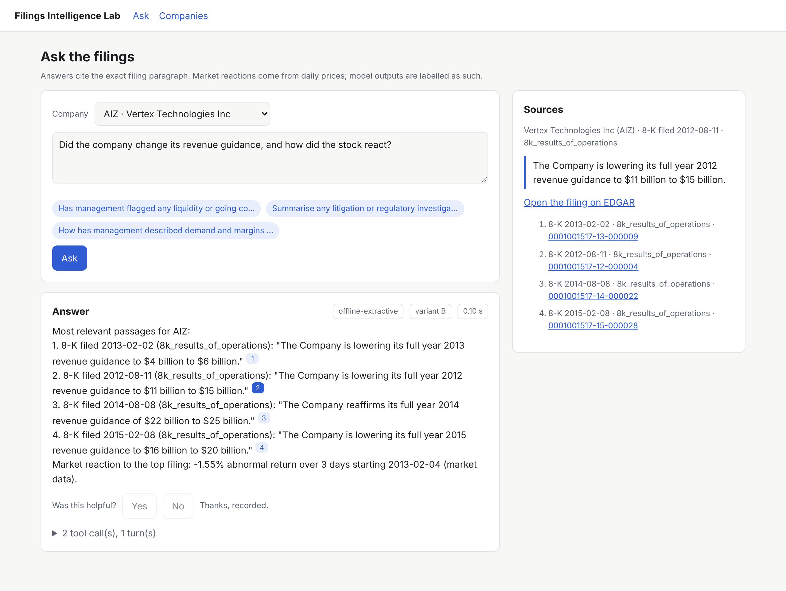
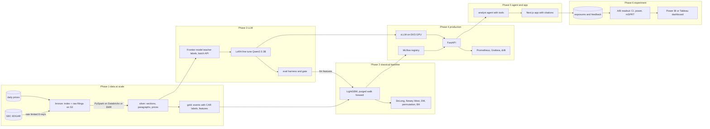

# Filings Intelligence Lab

Can the language in a company's SEC filings predict its stock's reaction? The lab answers that three ways,
in one system built in six phases: a classical model with honest statistics, a fine tuned small LLM that
extracts structured signals, and an analyst agent that answers questions with citations to the exact
filing paragraph. Everything runs end to end on a laptop against a synthetic EDGAR shaped world, and the
same code points at real EDGAR, S3, Databricks or EMR, EKS and a GPU for production scale.



## Architecture



## Phases

| Phase | What is built | Where | Doc |
|---|---|---|---|
| 1 Data at scale | Rate limited EDGAR client, bulk and API index builders, HTML and inline XBRL cleaning, TOC aware section extraction, stable paragraph ids, acceptance time event alignment, market model CARs, PySpark job verified identical to the local runner, Databricks bundle, EMR steps, Terraform, DuckDB SQL | `pipeline/`, `edgar/`, `text/`, `prices/`, `infra/` | [phase1](docs/phases/phase1_data.md) |
| 2 Classical baseline and statistics | Lexicon, change, rule and point in time XBRL features; purged walk forward LightGBM; DeLong, Newey West, block bootstrap, Diebold Mariano, permutation and Benjamini Hochberg tests; ablations and SHAP | `features/`, `modeling/`, `sql/` | [phase2](docs/phases/phase2_baseline.md) |
| 3 Fine tune an LLM | Strict signal schema, evidence selection, frontier model teacher with structured outputs and batch labelling, TRL and PEFT LoRA or QLoRA trainer, offline smoke test, eval harness with grounding checks and a regression gate | `llm/`, `configs/` | [phase3](docs/phases/phase3_llm.md) |
| 4 Serve it in production | FastAPI with circuit breaker and fallback, vLLM with multi LoRA, MLflow tracking and alias registry, drift (PSI, KS), Prometheus and Grafana, Kubernetes with HPA and KEDA, EKS Terraform, CI gate with GitOps promotion | `serving/`, `infra/k8s`, `infra/eks`, `.github/` | [phase4](docs/phases/phase4_serving.md) |
| 5 Analyst agent and app | Tools for search, paragraphs, filings, prices, event returns and model signals; LLM tool loop with verified citations; offline mode; Next.js and TypeScript app | `agent/`, `web/` | [phase5](docs/phases/phase5_agent.md) |
| 6 Experiment and dashboard | Sticky assignment, event log, power analysis, readout with clustered intervals, SRM check, mSPRT and guardrails; BI star schema, DAX and Tableau kits; published dashboard | `experiment/`, `dashboards/` | [phase6](docs/phases/phase6_experiment.md) |

Research and design decisions, with sources: [docs/RESEARCH.md](docs/RESEARCH.md).

Dashboards (A/B readout, reaction model and extraction model, built from `dashboards/data/`):
[dashboards/README.md](dashboards/README.md).

## Quickstart (synthetic world, about five minutes)

```bash
pip install -e ".[ml,serve,agent,dev]" tabulate duckdb
```

```bash
flab synth --out data/synthetic --companies 60
flab local --index data/synthetic/index.parquet --prices data/synthetic/prices.parquet --lake data/lake
flab features && flab train --permutations 20
```

```bash
flab llm-dataset && flab llm-eval --systems rules && flab llm-features --system rules
flab register --alias champion && flab serve
```

```bash
cd web && npm ci && FLAB_API_URL=http://localhost:8080 npm run dev
```

```bash
flab ab-plan && flab ab-simulate --users 3000 && flab ab-analyze && flab bi-export
```

`docker compose up --build` runs the API, the web app, MLflow, Prometheus and Grafana together.

## Running on real data

```bash
export SEC_USER_AGENT="Your Org you@example.com"
flab index --tickers universe.txt --start 2014-01-01 --end 2024-12-31 --out data/lake/bronze/index.parquet
flab download --index data/lake/bronze/index.parquet --raw data/lake/bronze/raw
```

Then run the Spark job on Databricks (`infra/databricks/databricks.yml`) or EMR (`infra/emr/run_pipeline.sh`)
with a licensed daily price file. Set `ANTHROPIC_API_KEY` for teacher labelling and the online agent; train
the adapter on a 24 GB GPU with `flab llm-train`.

## Honest scope

The synthetic world plants a weak, known relationship between language and returns so that every stage can
be executed and checked against the truth. Its results validate the machinery, not a trading claim. On real
filings, published work suggests out of sample AUC around 0.52 to 0.55; the lab treats anything above 0.65 as
a leakage bug until proven otherwise. Results for the fine tuned and frontier LLM need a GPU and an API key
and are not reported here; the commands that produce them are.

## Quality

```bash
pytest -q
ruff check src tests scripts
cd web && npm run lint && npm run typecheck && npm test && npm run build
```

CI runs these on Python 3.11 to 3.13, plus the PySpark parity test on Java 17, the LoRA smoke test on CPU
PyTorch and the model gate on every change to models, features or training code.

## Three stories from one system

1. Data engineering: a ten year EDGAR backfill with a polite downloader, a Spark lakehouse on S3 with
   bronze, silver and gold Parquet, identical results between cluster and laptop, and infrastructure as code.
2. Data science: leakage safe event labels, purged walk forward validation, and significance testing that
   separates a real signal from noise, followed by an A/B test analysed with clustered intervals, power
   analysis and sequential testing, published to a BI dashboard.
3. ML and AI engineering: distilling a frontier model into a LoRA fine tuned 3B model with an eval harness,
   serving it with vLLM on Kubernetes behind a gated CI/CD pipeline with drift monitoring, and an agent that
   cites its sources, in a TypeScript app.

## Repository layout

```
src/filings_lab/   edgar, text, prices, pipeline (Phase 1) · features, modeling (2) · llm (3)
                   serving (4) · agent (5) · experiment (6) · synthetic world · flab CLI
tests/             unit and integration tests for every phase
web/               Next.js 15 and TypeScript analyst app
infra/             Databricks, EMR, AWS and EKS Terraform, Kubernetes, monitoring
configs/           LoRA and QLoRA configs, experiment config
models/            production and candidate model records (GitOps promotion)
dashboards/        BI star schema exports, Power BI and Tableau kits
sql/               DuckDB analysis queries over the lake
docs/              research notes, one document per phase
```
