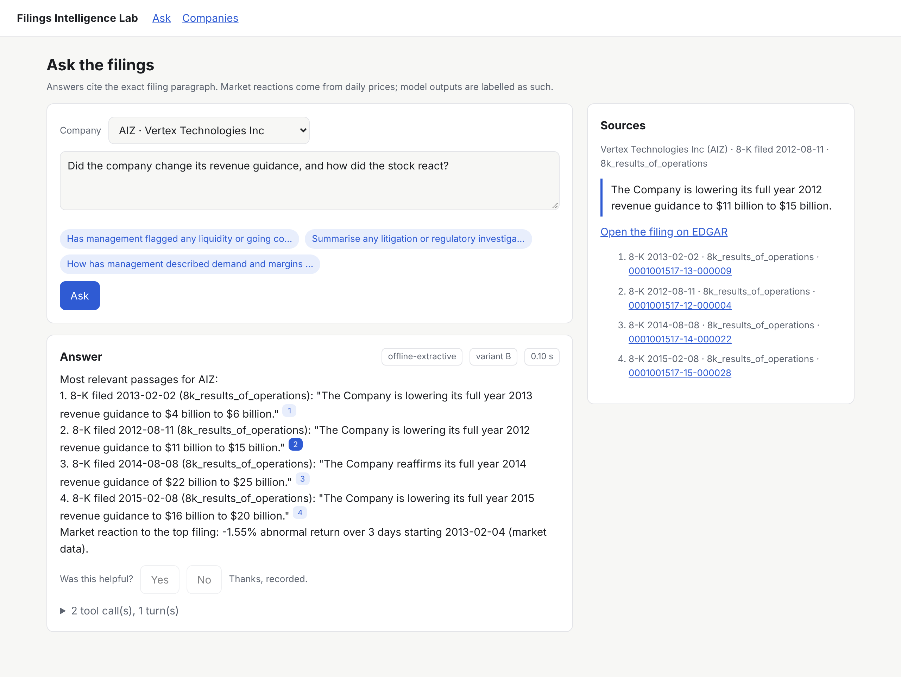

# Phase 5: Analyst agent and app

An analyst asks a question about a company in plain English and gets a short answer in which every
statement drawn from a filing links to the exact paragraph it came from.

## Agent (`filings_lab/agent`)

Tools (strict JSON schemas, `tools.py`):

| Tool | Returns |
|---|---|
| `search_filings(query, ticker, form, date_from, date_to, k)` | best paragraphs with paragraph ids (BM25, dense or hybrid ranking, see below; repeated paragraphs collapsed, MMR diversification, filters applied before ranking) |
| `get_paragraph(paragraph_id)` | full text, neighbouring paragraph ids, EDGAR URL |
| `list_filings(ticker, form, limit)` | a company's filings with their 3 day abnormal return |
| `get_price_history(ticker, start, end)` | return, drawdown, volatility, weekly closes |
| `get_event_return(accession)` | day 0 return and CAR[0,+2] for one filing |
| `extract_signals(accession)` | runs the extraction model this session serves (its A/B variant's LoRA adapter on vLLM, rules offline) and returns signals with quotes resolved to paragraph ids; only quotes the cited paragraph really contains become citable, and a fallback to rules is recorded per request |
| `get_model_signal(accession)` | stored LLM signals and the reaction model's probability with drivers |

Citation integrity: the tool box records every paragraph id it returns during a request. The validator
accepts a citation only if its id is in that set. If the model cites an id it was never shown, the agent
sends one repair turn listing the bad ids; whatever is still invalid after that is returned flagged, and the
UI shows it with a dashed outline instead of hiding it. `citation_valid_rate` is logged for every answer and
is an A/B guardrail in Phase 6.

Online agent loop (`agent.py`): a hosted frontier model (`FLAB_AGENT_MODEL` sets which), effort high, a cacheable system
prompt, strict tools with automatic tool choice, the full assistant content appended every turn so thinking
blocks replay unchanged, all tool results of a turn returned in one message, explicit handling of
`tool_use`, `pause_turn`, `refusal` and `max_tokens`, server side refusal fallback, a turn cap and token cost
accounting. A scripted fake client tests the loop deterministically (`tests/test_agent.py`).

The same loop on a free API (`agent/openai_agent.py`, `openai_compat.py`): `OpenAIChatAgent` speaks the OpenAI
chat completions format, so the agent runs on NVIDIA's free hosted endpoints (the default, `NVIDIA_API_KEY`) or on
any compatible server. The loop is the one above; what differs is the wire format and what an open model needs
forgiven. Arguments the tool does not declare are dropped, arguments that are not valid JSON are reported back to
the model as a tool error so it can retry, and reasoning printed inside `<think>` tags is removed from the answer.
The client spaces requests under the free tier's limit of about 40 a minute and backs off on a 429, honouring
`Retry-After`. The service picks the paid model when its key is set, this one when only its key is set, and the
offline agent otherwise. Tested against a scripted client (`tests/test_openai_compat.py`); not yet run against the
real API.

Offline mode: without an API key the service answers with `ExtractiveAgent`: the same retrieval and tools,
quoting the most relevant sentence of each hit with its citation and the market reaction to the top filing.
The service also falls back to it if the API errors. BM25 ranks on whichever query words it knows, so when a
content word of the question appears in no indexed filing the answer says so first ("No indexed filing uses
the term 'liquidity'") instead of presenting matches on the other words as an answer.

## Retrieval: keyword, dense and hybrid (`agent/retrieval.py`, `agent/embeddings.py`)

`search_filings` runs on one of three indexes behind one interface. `FLAB_RETRIEVAL` picks the default, and an
experiment variant can set `retrieval` in its config, so the Phase 6 framework can test one against another.

| Mode | How it ranks |
|---|---|
| `bm25` (default, needs no model) | one sparse matrix product over paragraph term weights |
| `dense` | cosine similarity against cached sentence embeddings (`BAAI/bge-small-en-v1.5`, 384 dimensions, ONNX on CPU, no PyTorch; `pip install -e ".[dense]"`) |
| `hybrid` | reciprocal rank fusion of the two, with a coverage gate on the keyword side |

Four design points, each put in after a measured failure:

1. Embeddings are cached by a hash of the paragraph text. The 57,486 paragraphs of the synthetic lake hold only
   25,751 distinct texts, because filings repeat themselves, so each is embedded once (`flab embed`, about 13
   minutes on an M2 CPU that was busy with other work, 21 MB at half precision) and a later build embeds only texts
   it has not seen.
2. Repeated paragraphs collapse to one result, the most recent filing's copy. Without this, ten copies of one risk
   factor fill a top ten. The gain is small here (dense nDCG@10 on paraphrased queries 0.600 to 0.615) and free.
3. The coverage gate. Rank fusion cannot tell a keyword ranking that found the answer from one that ranked noise.
   On paraphrased queries BM25's best paragraphs share one incidental word with the question, and fusing them in
   took plain fusion to 0.551 against 0.615 for dense alone. A BM25 result now enters the fusion only if it holds
   at least half of the query's content words; below that the dense ranking stands alone (0.613). The gate costs
   a little where keywords do work (0.888 against 0.897 without it on keyword style queries).
4. A company's own name is removed from a query already filtered to that company. Inside one company's filings the
   name separates nothing, but it is in every "X issued a press release" line, and both rankers score that
   boilerplate above the answer. With the name left in, the agent below gets 0.600 of its dated guidance questions
   right with hybrid retrieval; with it removed, 0.925.

### Measured (`flab retrieval-eval`, [eval/retrieval/report.md](../../eval/retrieval/report.md))

The generator writes each fact with a sentence from a known bank, so which paragraphs state a fact is known
exactly. Seventeen information needs are asked two ways, with words from the filing sentence and as paraphrases
("management cut its sales forecast" for "lowering its revenue guidance"), plus lookups of an exact figure generated
from the paragraphs themselves. Every query runs per company, scoped as the agent's searches are: 1,012 query and
company pairs, scored on distinct texts.

| Query set | Pairs | BM25 nDCG@10 | Dense | Hybrid | Hybrid minus BM25 [95% CI] |
|---|---:|---:|---:|---:|---|
| keyword style | 240 | 0.887 | 0.884 | 0.888 | +0.002 [0.000, +0.005] |
| paraphrased | 612 | 0.118 | 0.615 | 0.613 | +0.495 [+0.382, +0.601] |
| exact figure | 160 | 1.000 | 1.000 | 1.000 | 0.000 |

How to read this:

1. Keyword search is blind to paraphrase: it puts a relevant paragraph in the top five for 17% of paraphrased
   queries, dense retrieval for 75%.
2. Hybrid never beats the better single ranker on this corpus. What it buys is never being the worse one. BM25
   loses half the scale on paraphrases; dense alone loses on the agent's dated guidance questions below (0.475
   against 1.000 for BM25), where a month holds twenty paragraphs and only the words "full year guidance" pick the
   right one. Hybrid is within 0.08 of the best ranker on both.
3. One need fails for every system. Paraphrases of a going concern warning ("the business may not survive") score
   0.000: "going concern" is accounting vocabulary, and the encoder ranks the true paragraph hundreds of places
   down (250th and 562nd of about 950 in the two cases inspected), behind risk factor boilerplate about debt and
   the economy. A general purpose 33M parameter encoder
   does not know this domain's terms; fine tuning it on filing text or expanding the query are the open fixes.
4. The exact figure set does not separate the systems: on sentences this short the encoder distinguishes the
   figures as well as the keywords do.
5. A cross encoder reranker was tried and left out (`scripts/rerank_trial.py`,
   [rerank_trial.json](../../eval/retrieval/rerank_trial.json)). Reranking the top 30 of each ranker with
   `ms-marco-MiniLM-L-6-v2` moved paraphrased nDCG@10 from 0.613 to 0.644 and hit@1 from 0.624 to 0.691, for a median
   of 0.85 seconds per query on CPU (p95 2.7 seconds) against about 20 milliseconds without it. Not worth it at this
   size; with a GPU beside the API it would be.

Limits, stated plainly. The paraphrases were written with the generator's sentences in view, so the keyword set is
easy and the paraphrase set hard for BM25 by construction: the table shows the mechanism, not the size of the gain
on real filings. The coverage gate and its threshold were chosen after the first run on these same queries, so the
hybrid row is optimistic; the BM25 and dense rows are not affected.

## Agent evaluation (`flab agent-eval`, [eval/agent/report.md](../../eval/agent/report.md))

240 questions with answers the generator knows, each checked mechanically, so no model grades another model:

| Question type | Example | Right when |
|---|---|---|
| guidance, dated (40) | "Did X raise, lower or keep its full year guidance in the earnings release it filed in May 2019?" | the answer cites that filing's guidance paragraph and states the direction |
| reaction, dated (40) | "How did the stock react to the earnings release X filed in May 2019?" | the answer gives that filing's 3 day abnormal return |
| disclosure made (80) | "Has a securities class action been filed against X?" | the answer cites a paragraph that states it |
| no such disclosure (80) | the same questions, for companies that never disclosed the event | the answer says so |

The offline extractive agent, by retrieval mode, with and without scoping a dated question to its month:

| Configuration | Guidance | Reaction | Disclosure made | No such disclosure | Citations valid |
|---|---:|---:|---:|---:|---:|
| BM25 | 0.625 | 0.850 | 1.000 | 0.150 | 1.000 |
| BM25, dated questions scoped | 1.000 | 1.000 | 1.000 | 0.150 | 1.000 |
| dense, dated questions scoped | 0.475 | 1.000 | 1.000 | 0.000 | 1.000 |
| hybrid, dated questions scoped | 0.925 | 1.000 | 1.000 | 0.000 | 1.000 |
| hybrid, dated questions scoped, company name kept | 0.600 | 1.000 | 1.000 | 0.000 | 1.000 |

1. Scoping is the largest single effect. A question about "the release filed in May 2019" is now searched within
   May 2019 (`question_period`), as an analyst would filter: guidance questions go from 0.625 to 1.000 with BM25
   (paired difference +0.375, 95% CI +0.225 to +0.525).
2. Hybrid misses three guidance questions of 40. In all three the filing says "outlook" where the question says
   "guidance", so the keyword hit covers under a quarter of the question's words and is gated out, and the dense
   ranking puts the sentence ninth to twelfth of about twenty. That is the gate's cost on long questions.
3. The offline agent cannot say no. It answers "not disclosed" questions correctly only when nothing matches at all
   (15% with BM25) and never with dense or hybrid retrieval, which always return their nearest paragraphs. Reading
   the passages and concluding that they do not answer the question is the hosted model's job.
4. No hosted model has been scored: no API key was available where this was built. `flab agent-eval --agent
   openai` (a free NVIDIA key) or `--agent claude` runs the same 240 questions through the tool loop and writes the
   same report, with the answers saved beside the marks, since a model's free wording can fail the direction and
   absence patterns that suit an agent which only quotes. Tests run both paths against scripted clients. At 40
   requests a minute a full run takes a while, so start with `--per-type 10`.

## API routes (mounted into the Phase 4 service)

`POST /v1/agent/ask`, `POST /v1/feedback`, `GET /v1/companies`, `GET /v1/companies/{ticker}/filings`,
`GET /v1/companies/{ticker}/prices`, `GET /v1/paragraphs/{id}`, `GET /v1/experiments/current`.

## Frontend (`web/`, Next.js 15, React 19, TypeScript strict)

1. Ask page: company picker, question box with examples, answer with numbered citation chips, a source panel
   that loads the cited paragraph with a link to the filing on EDGAR, feedback buttons, the tool trace, and
   badges for mode, A/B variant, latency and cost.
2. Company page: weekly price chart (dependency free SVG) with filing reactions marked, and the filings
   table with each filing's 3 day abnormal return.
3. Next.js route handlers proxy to the Python API and add the API key on the server, so it never reaches the
   browser. Middleware sets an anonymous `flab_uid` cookie, the unit of randomisation for the A/B test.
4. Checks: `npm run lint`, `npm run typecheck`, `npm test` (vitest: citation parsing and formatting),
   `npm run build`; all run in CI.

4. Filing viewer: every citation opens the filing at the cited paragraph, highlighted, with section
   navigation and a link to the original on EDGAR.
5. Experiment page: the live A/B readout (decision, lift with clustered and always valid intervals, arms,
   traffic split and guardrail checks).
6. Review page: human review of teacher labels with agreement and Cohen's kappa (Phase 3).

Verified end to end in this environment: the API and the Next.js server ran together and a headless browser
asked a question, opened a citation, recorded feedback and loaded a company page with no page errors; the
exposure and the rating landed in the experiment log with the assigned variant.

## Scaling notes

The in memory store and indexes suit a few hundred companies: dense scores are one matrix product over the
distinct texts (about 7 ms per query here, plus about 8 ms to encode the query). For all of EDGAR: OpenSearch
(BM25 plus a dense vector field) for `search_filings`, warehouse tables for events and prices, and the online
feature store for model outputs; the tool interfaces stay the same. The serving image does not yet carry the
embedding model, so a deployment that sets `FLAB_RETRIEVAL=hybrid` without it falls back to BM25 and logs that it
did (`tests/test_retrieval.py`).
