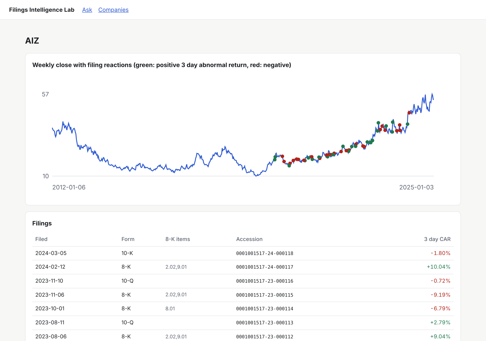
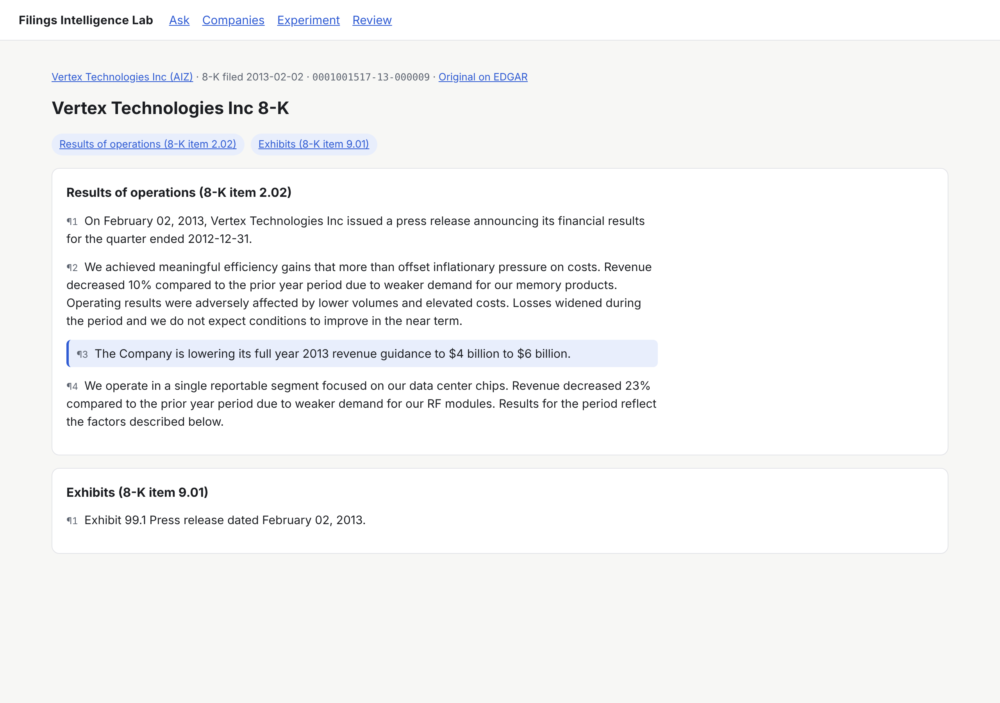
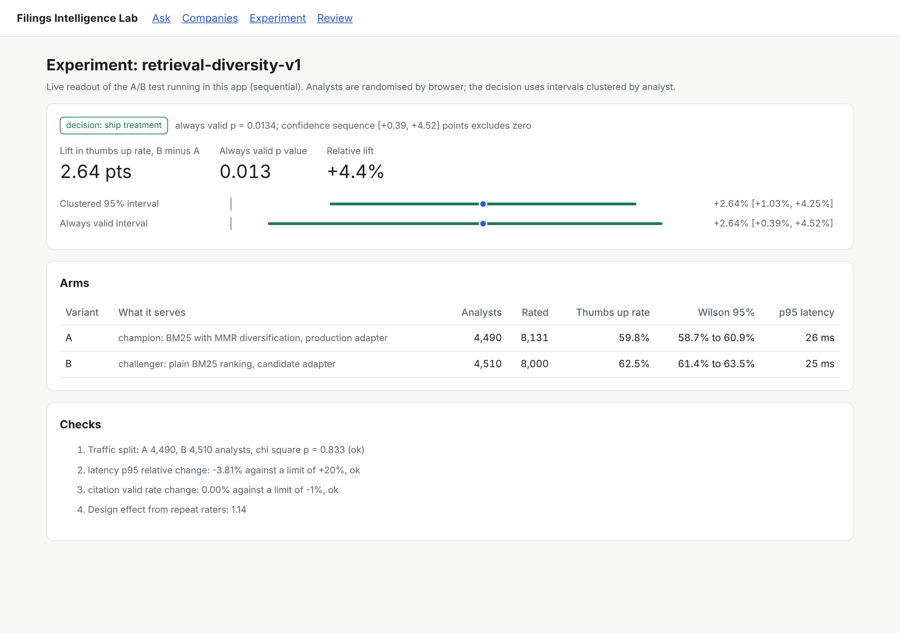
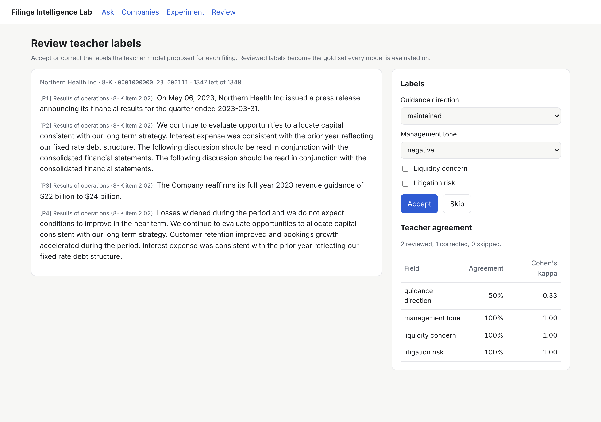

# Phase 5: Analyst agent and app

An analyst asks a question about a company in plain English and gets a short answer in which every
statement drawn from a filing links to the exact paragraph it came from.

## Agent (`filings_lab/agent`)

Tools (strict JSON schemas, `tools.py`):

| Tool | Returns |
|---|---|
| `search_filings(query, ticker, form, date_from, date_to, k)` | best paragraphs with paragraph ids (BM25, dense or hybrid ranking, see below; repeated paragraphs collapsed, MMR diversification, filters applied before ranking) |
| `get_paragraph(paragraph_id)` | full text, neighbouring paragraph ids, EDGAR URL |
| `list_filings(ticker, form, limit)` | a company's filings with their 3 day abnormal return |
| `get_price_history(ticker, start, end)` | return, drawdown, volatility, weekly closes |
| `get_event_return(accession)` | day 0 return and the 3 day abnormal return, CAR[0,+2], for one filing (`car_3d`, with the market model estimate beside it) |
| `extract_signals(accession)` | runs the extraction model this session serves (its A/B variant's LoRA adapter on vLLM, rules offline) and returns signals with quotes resolved to paragraph ids; only quotes the cited paragraph really contains become citable, and a fallback to rules is recorded per request |
| `get_model_signal(accession)` | stored LLM signals and the reaction model's probability with drivers |

Citation integrity: the tool box records every paragraph id it returns during a request. The validator
accepts a citation only if its id is in that set. If the model cites an id it was never shown, the agent
sends one repair turn listing the bad ids; whatever is still invalid after that is returned flagged, and the
UI shows it with a dashed outline instead of hiding it. `citation_valid_rate` is logged for every answer and
is an A/B guardrail in Phase 6.

Online agent loop (`agent.py`): a hosted frontier model (`FLAB_AGENT_MODEL` sets which), effort high, a cacheable system
prompt, strict tools with automatic tool choice, the full assistant content appended every turn so thinking
blocks replay unchanged, all tool results of a turn returned in one message, explicit handling of
`tool_use`, `pause_turn`, `refusal` and `max_tokens`, server side refusal fallback, a turn cap and token cost
accounting. On the last turn the request withdraws the tools (`tool_choice` none, the definitions stay so the
cached prefix still matches) and an instruction to answer from what was found follows the tool results in the same
message, so a search that never ends still produces an answer. A scripted fake client tests the loop
deterministically (`tests/test_agent.py`). This loop has not been run against the paid API.

The same loop on a free API (`agent/openai_agent.py`, `openai_compat.py`): `OpenAIChatAgent` speaks the OpenAI
chat completions format, so the agent runs on NVIDIA's free hosted endpoints (the default, `NVIDIA_API_KEY`) or on
any compatible server. The loop is the one above; what differs is the wire format and what an open model needs
forgiven, and every item on this list was added after a live model did it:

* the text "None" sent for an empty filter, which turned each optional filter into a search for the word None;
* arguments the tool does not declare, and arguments that are not valid JSON (reported back as a tool error so
  the model can retry);
* reasoning printed inside `<think>` tags;
* citations in other shapes: `[cite:<id>]`, full width brackets, two ids in one bracket (`tidy_answer` rewrites
  them into the one form the validator reads);
* a reply with neither a tool call nor text, which gets one request to answer;
* a turn budget spent entirely on searching, which is why the last turn withdraws the tools.

The client (`ChatClient`) spaces requests and treats a timeout or a dropped connection like a 5xx. The published
free limit is about 40 requests a minute, but the largest model answered 429 for minutes at 17 a minute, with no
`Retry-After`. So the pace adapts: a 429 seen by one thread holds all of them and halves the request rate, and the
rate climbs back a step for every twenty answers. The service picks the paid model when its key is set, this one
when only its key is set, and the offline agent otherwise. Scripted clients test all of it
(`tests/test_openai_compat.py`), and two free models have been scored through it (below).

Offline mode: without an API key the service answers with `ExtractiveAgent`: the same retrieval and tools,
quoting the most relevant sentence of each hit with its citation and the market reaction to the top filing.
The service also falls back to it if the API errors. BM25 ranks on whichever query words it knows, so when a
content word of the question appears in no indexed filing the answer says so first ("No indexed filing uses
the term 'liquidity'") instead of presenting matches on the other words as an answer.

## Retrieval: keyword, dense and hybrid (`agent/retrieval.py`, `agent/embeddings.py`)

`search_filings` runs on one of three indexes behind one interface. `FLAB_RETRIEVAL` picks the default, and an
experiment variant can set `retrieval` in its config, so the Phase 6 framework can test one against another.

| Mode | How it ranks |
|---|---|
| `bm25` (default, needs no model) | one sparse matrix product over paragraph term weights |
| `dense` | cosine similarity against cached sentence embeddings (`BAAI/bge-small-en-v1.5`, 384 dimensions, ONNX on CPU, no PyTorch; `pip install -e ".[dense]"`) |
| `hybrid` | reciprocal rank fusion of the two, with a coverage gate on the keyword side |

Four design points, each put in after a measured failure:

1. Embeddings are cached by a hash of the paragraph text. The 57,486 paragraphs of the synthetic lake hold only
   25,751 distinct texts, because filings repeat themselves, so each is embedded once (`flab embed`, about 13
   minutes on an M2 CPU that was busy with other work, 21 MB at half precision) and a later build embeds only texts
   it has not seen.
2. Repeated paragraphs collapse to one result, the most recent filing's copy. Without this, ten copies of one risk
   factor fill a top ten. The gain is small here (dense nDCG@10 on paraphrased queries 0.600 to 0.615) and free.
3. The coverage gate. Rank fusion cannot tell a keyword ranking that found the answer from one that ranked noise.
   On paraphrased queries BM25's best paragraphs share one incidental word with the question, and fusing them in
   took plain fusion to 0.551 against 0.615 for dense alone. A BM25 result now enters the fusion only if it holds
   at least half of the query's content words; below that the dense ranking stands alone (0.613). The gate costs
   a little where keywords do work (0.888 against 0.897 without it on keyword style queries).
4. A company's own name is removed from a query already filtered to that company. Inside one company's filings the
   name separates nothing, but it is in every "X issued a press release" line, and both rankers score that
   boilerplate above the answer. With the name left in, the agent below gets 0.600 of its dated guidance questions
   right with hybrid retrieval; with it removed, 0.925.

### Measured (`flab retrieval-eval`, [eval/retrieval/report.md](../../eval/retrieval/report.md))

The generator writes each fact with a sentence from a known bank, so which paragraphs state a fact is known
exactly. Seventeen information needs are asked two ways, with words from the filing sentence and as paraphrases
("management cut its sales forecast" for "lowering its revenue guidance"), plus lookups of an exact figure generated
from the paragraphs themselves. Every query runs per company, scoped as the agent's searches are: 1,012 query and
company pairs, scored on distinct texts.

| Query set | Pairs | BM25 nDCG@10 | Dense | Hybrid | Hybrid minus BM25 [95% CI] |
|---|---:|---:|---:|---:|---|
| keyword style | 240 | 0.887 | 0.884 | 0.888 | +0.002 [0.000, +0.005] |
| paraphrased | 612 | 0.118 | 0.615 | 0.613 | +0.495 [+0.382, +0.601] |
| exact figure | 160 | 1.000 | 1.000 | 1.000 | 0.000 |

How to read this:

1. Keyword search is blind to paraphrase: it puts a relevant paragraph in the top five for 17% of paraphrased
   queries, dense retrieval for 75%.
2. Hybrid never beats the better single ranker on this corpus. What it buys is never being the worse one. BM25
   loses half the scale on paraphrases; dense alone loses on the agent's dated guidance questions below (0.475
   against 1.000 for BM25), where a month holds twenty paragraphs and only the words "full year guidance" pick the
   right one. Hybrid is within 0.08 of the best ranker on both.
3. One need fails for every system. Paraphrases of a going concern warning ("the business may not survive") score
   0.000: "going concern" is accounting vocabulary, and the encoder ranks the true paragraph hundreds of places
   down (250th and 562nd of about 950 in the two cases inspected), behind risk factor boilerplate about debt and
   the economy. A general purpose 33M parameter encoder
   does not know this domain's terms; fine tuning it on filing text or expanding the query are the open fixes.
4. The exact figure set does not separate the systems: on sentences this short the encoder distinguishes the
   figures as well as the keywords do.
5. A cross encoder reranker was tried and left out (`scripts/rerank_trial.py`,
   [rerank_trial.json](../../eval/retrieval/rerank_trial.json)). Reranking the top 30 of each ranker with
   `ms-marco-MiniLM-L-6-v2` moved paraphrased nDCG@10 from 0.613 to 0.644 and hit@1 from 0.624 to 0.691, for a median
   of 0.85 seconds per query on CPU (p95 2.7 seconds) against about 20 milliseconds without it. Not worth it at this
   size; with a GPU beside the API it would be.

Limits, stated plainly. The paraphrases were written with the generator's sentences in view, so the keyword set is
easy and the paraphrase set hard for BM25 by construction: the table shows the mechanism, not the size of the gain
on real filings. The coverage gate and its threshold were chosen after the first run on these same queries, so the
hybrid row is optimistic; the BM25 and dense rows are not affected.

## Agent evaluation (`flab agent-eval`, [eval/agent/report.md](../../eval/agent/report.md))

240 questions with answers the generator knows, each checked mechanically, so no model grades another model:

| Question type | Example | Right when |
|---|---|---|
| guidance, dated (40) | "Did X raise, lower or keep its full year guidance in the earnings release it filed in May 2019?" | the answer cites that filing's guidance paragraph and states the direction |
| reaction, dated (40) | "How did the stock react to the earnings release X filed in May 2019?" | the answer gives that filing's 3 day abnormal return, to one decimal place or better |
| disclosure made (80) | "Has a securities class action been filed against X?" | the answer cites a paragraph that states it |
| no such disclosure (80) | the same questions, for companies that never disclosed the event | the answer says so |

The offline extractive agent, by retrieval mode, with and without scoping a dated question to its month:

| Configuration | Guidance | Reaction | Disclosure made | No such disclosure | Citations valid |
|---|---:|---:|---:|---:|---:|
| BM25 | 0.625 | 0.850 | 1.000 | 0.150 | 1.000 |
| BM25, dated questions scoped | 1.000 | 1.000 | 1.000 | 0.150 | 1.000 |
| dense, dated questions scoped | 0.475 | 1.000 | 1.000 | 0.000 | 1.000 |
| hybrid, dated questions scoped | 0.925 | 1.000 | 1.000 | 0.000 | 1.000 |
| hybrid, dated questions scoped, company name kept | 0.600 | 1.000 | 1.000 | 0.000 | 1.000 |

1. Scoping is the largest single effect. A question about "the release filed in May 2019" is now searched within
   May 2019 (`question_period`), as an analyst would filter: guidance questions go from 0.625 to 1.000 with BM25
   (paired difference +0.375, 95% CI +0.225 to +0.525).
2. Hybrid misses three guidance questions of 40. In all three the filing says "outlook" where the question says
   "guidance", so the keyword hit covers under a quarter of the question's words and is gated out, and the dense
   ranking puts the sentence ninth to twelfth of about twenty. That is the gate's cost on long questions.
3. The offline agent cannot say no. It answers "not disclosed" questions correctly only when nothing matches at all
   (15% with BM25) and never with dense or hybrid retrieval, which always return their nearest paragraphs. Reading
   the passages and concluding that they do not answer the question is the hosted model's job.
4. Two free hosted models were scored on a fresh draw of the same kinds of question (next section).
   `flab agent-eval --agent openai` (any OpenAI compatible API, NVIDIA's free endpoints by default) or `--agent
   claude` runs the questions through the tool loop and writes the same report, with each answer saved beside its
   marks, since a model's free wording can fail the direction and absence patterns that suit an agent which only
   quotes.

### Hosted models on NVIDIA's free endpoints

Two models went through the free API loop: `nvidia/nemotron-3.5-lightning-30b-a3b` and
`nvidia/nemotron-3-ultra-550b-a55b`, the default (the names give total and active parameters: 30B with 3B active,
550B with 55B active). Every run, its answers and its marks are in [eval/agent_hosted](../../eval/agent_hosted/README.md).
Each answered 60 questions per retrieval mode, 10 dated guidance, 10 dated reaction, 20
disclosure made and 20 no such disclosure, drawn with `--seed 2`, and the offline agent answered the same 60. A
hosted model gets the question and the ticker in focus and sets its own filters, so it has no scoped variant: on
every dated guidance question, both models' first search was already limited to the month the question names.

| Agent | Retrieval | Guidance (10) | Reaction (10) | Disclosure made (20) | No such disclosure (20) | Mean | Turns | Latency p50 |
|---|---|---:|---:|---:|---:|---:|---:|---:|
| offline, dated questions scoped | BM25 | 1.000 | 1.000 | 1.000 | 0.100 | 0.775 | 1.0 | 5 ms |
| offline, dated questions scoped | hybrid | 1.000 | 1.000 | 1.000 | 0.000 | 0.750 | 1.0 | 8 ms |
| Nemotron 3.5 Lightning | BM25 | 0.900 | 1.000 | 0.850 | 1.000 | 0.938 | 4.7 | 31 s |
| Nemotron 3.5 Lightning | hybrid | 1.000 | 1.000 | 0.950 | 0.950 | 0.975 | 4.5 | 28 s |
| Nemotron 3 Ultra | BM25 | 1.000 | 1.000 | 1.000 | 1.000 | 1.000 | 4.6 | 233 s |
| Nemotron 3 Ultra | hybrid | 1.000 | 1.000 | 1.000 | 1.000 | 1.000 | 4.5 | 230 s |

Every citation in every row was valid, and the hosted runs cost nothing. With 10 questions a type one answer moves a
cell by 0.100. A bootstrap interval around a perfect score collapses to a point, so for those cells the exact
binomial interval is the one to quote: 10 of 10 right is consistent with a true rate as low as 0.69, and 20 of 20
with one as low as 0.83. The reports print every interval.

How to read it:

1. Saying no is what a model adds. On "no such disclosure" the offline agent is right on 2 or 0 of 20, because
   retrieval always returns its nearest paragraphs and the agent quotes them. Both models read those paragraphs and
   say that none of them states the event: 19 or 20 of 20 for the smaller model, 20 of 20 in both modes for the
   larger.
2. Everything else the offline agent already gets right, once a person has scoped its dated questions. The models
   scope those themselves. The smaller one gives up a few disclosures made, mostly to the citation format (below),
   and the larger gives up nothing.
3. With a model in the loop retrieval matters less. For the smaller model hybrid minus BM25 is +0.100 on guidance
   [0.000, +0.300] and +0.100 on disclosures made [-0.100, +0.300], neither distinguishable from zero at this size,
   and for the larger it is zero on every type. The smaller model's one BM25 guidance miss is the vocabulary gap
   from the table above: the filing says "outlook", a BM25 search for "guidance" in that month returned nothing,
   and the model said the filing did not state it. With hybrid retrieval it found the paragraph.
4. Time is the price. The two runs shared one free key and ran side by side, four and three questions in flight.
   The smaller model took 44 minutes for its 120 answers and the larger just under three hours, most of it waiting
   out the rate limit: in the hybrid half, the only one counted, the API refused 36 of the smaller model's 306
   requests and 103 of the larger's 376 with a 429. The latency column includes those waits.

The misses on this draw, one by one. The smaller model missed 6 of 120:

* BM25, guidance: the vocabulary gap above.
* BM25, three disclosures made: each answer named the right paragraph, as "paragraph [e4e8e7f0bbddba08]" or
  "paragraph **5081844f83bf3279**", without `cite:`. The app links only `[cite:<id>]`, so a reader would see no
  source, and the check counts them wrong.
* hybrid, a disclosure made: asked whether the company appointed a new chief financial officer, it found the
  appointments of 2013, 2015 and 2018, read "new" as "recent", searched 2023 onward and answered no, citing none of
  the three.
* hybrid, a no such disclosure question: on the last turn, with the tools withdrawn, it wrote out a tool call as
  text instead of an answer.

The larger model missed none of its 120. A perfect score is a reason to doubt the checker, so every one of those
answers was read: each gives one direction, or the 3 day abnormal return with the market model estimate labelled
apart, or a plain yes with the stating paragraph cited, or a plain no. Where a company had warned of going concern
doubt but never said it needed more capital, the answer said exactly that.

None of these was fixed. The code and the checker were frozen before this draw; the list below is how they got
there.

#### What the development runs changed

Two earlier runs were the development set: the larger model on `--seed 0`
([first_run](../../eval/agent_hosted/first_run/report.md)) and the smaller on `--seed 1`
([second_run](../../eval/agent_hosted/second_run/report.md)). Every change below came from reading their answers.
The table above is a third draw that shares 5 of its 60 questions with the first two, and the earlier reports are
kept as they were produced.

1. The checker was wrong twice. Models write a minus as an en dash or a non breaking hyphen (U+2011), which the
   reaction check did not read as a sign, and markdown bold split "does **not** state", so the absence pattern
   missed it. With both fixed and no answer changed, the first run's BM25 reaction score went from 0.300 to 0.700
   and its no such disclosure score from 0.900 to 1.000. In the second run three returns rounded to one decimal
   place were marked wrong; a return now counts at the precision it is written to (within 0.05 points at one
   decimal, within 0.011 at two or more, and never as a whole number).
2. Filters nobody asked for. The larger model put a `date_from` in 2020 on its searches unasked, which hid every
   older filing, and missed 4 disclosures that way. The tool description now says null is the right value for a
   filter the question does not call for, and the prompt says a question such as "has the company ever disclosed X"
   covers the whole filing history. On the final draw no first search of an undated question carried a date (0 of
   160 across both models). Later searches still added dates at times, mostly to check recent filings after finding
   nothing (5 of the smaller model's 80 undated questions, 20 of the larger's), and that cost one answer: the chief
   financial officer question above.
3. The wrong filing. Asked how the stock reacted to an earnings release, the larger model twice reported the
   reaction to the 10-Q for the same quarter. The prompt now says an earnings release is the 8-K with Item 2.02, and
   the periodic report a different filing with its own reaction.
4. An ambiguous field. `get_event_return` returned `car_0_2` and `car_market_model`, and one answer gave the market
   model estimate (+8.03%) as the 3 day abnormal return (+10.23%). The fields are now `car_3d` and
   `car_3d_market_model`, with a note that says which one is the reaction.
5. An outage. The first run lost 24 of its 60 hybrid answers to API errors within a few minutes and kept no error
   text. Errors now keep their text, a question that ended in an API error is asked again after a pause
   (`--retries`), each answer is appended to `progress.jsonl` as it arrives so a stopped run resumes, and the client
   paces itself as described above. Both final runs ended with no errors left.
6. Reasoning spends the token budget. These models reason before they answer and the reasoning counts against
   `max_tokens`; the extraction run in phase 3 lost 76 of 100 answers to it. The agent's cap went from 2,000 to 4,096.
7. Citations and silence. The second run wrote `【cite:id】` and `[cite:a; cite:b]`, and once replied with nothing at
   all. `tidy_answer` and the one request to answer handle those. A bare id without `cite:` is still not read as a
   citation, for the reason above.

Limits, stated plainly. Sixty questions a mode is small. The questions come from the synthetic world, where filings
are short and each fact sits in a known sentence; real filings are longer and vaguer. The fixes were made by reading
the answers of the first two draws, so those runs' numbers are not evidence, only the seed 2 table is. And the checks
are patterns: an answer worded in a way they do not expect is marked wrong, so the reports keep every answer beside
its marks.

### On real filings ([eval/real/agent_examples.md](../../eval/real/agent_examples.md))

The same agent, with the smaller free model and BM25, answered ten questions about real companies from the lake
built out of their EDGAR filings (the 20 company pilot, 2019 to 2024, 167,227 paragraphs; `scripts/ask_real.py`,
questions in `configs/real_questions.json`). Real questions have no answer key, so the file prints the full text of
every cited paragraph under each answer, and each answer was read against its sources:

| Question | Answer | Read against the cited paragraphs |
|---|---|---|
| Walmart's guidance in the August 2024 release | raised, with the updated and original ranges | right |
| Nvidia's reaction to its May 2024 release | day 0 +9.3%, 3 day abnormal return +18.9% | right (from the event table) |
| ExxonMobil and Pioneer | all stock, $59.5 billion, $253 a share, closed May 2024 with 545 million shares issued | right, but a summary table calls the $59.5 billion "enterprise value", which the filing does not |
| JPMorgan and First Republic | bought from the FDIC on 1 May 2023, $2.7 billion bargain purchase gain | right |
| Boeing and Alaska Airlines Flight 1282 | inspections, production slowed, financial impact, the FAA's enhanced inspection | right, except that it calls Spirit Boeing's final assembly site; the paragraph says fuselages are inspected at Spirit |
| Pfizer's COVID product revenue in 2023 | $13.5 and $8 billion expected, cut by $9 billion to $12.5 billion in October | right, but it puts the $11.5 billion Comirnaty figure on a paragraph that does not state it (a later cited one does) |
| Coca-Cola and the IRS | the $3.3 billion notice of 2015 and the litigation designation | right, but it calls a 2024 10-Q "the same 10-Q" as one from 2021 |
| Apple's gross margin in fiscal 2024 | products up on cost savings, offset by mix and currency; services up on services sales | right |
| Visa and going concern | no such disclosure | right |
| Home Depot's buyback | the $15 billion authorization of August 2023 | right, but the paragraph is named as "[81357460dc69efca]" without `cite:`, so it is not a citation |

Every headline answer is right and every citation is valid; four answers carry a detail their cited paragraph does
not support, and one cites in the form the synthetic evaluation also counted wrong. Ten questions chosen by hand
are a demonstration, not a measurement.

## API routes (mounted into the Phase 4 service)

`POST /v1/agent/ask`, `POST /v1/feedback`, `GET /v1/companies`, `GET /v1/companies/{ticker}/filings`,
`GET /v1/companies/{ticker}/prices`, `GET /v1/paragraphs/{id}`, `GET /v1/experiments/current`.

## Frontend (`web/`, Next.js 15, React 19, TypeScript strict)

1. Ask page: company picker, question box with examples, answer with numbered citation chips, a source panel
   that loads the cited paragraph with a link to the filing on EDGAR, feedback buttons, the tool trace, and
   badges for mode, A/B variant, latency and cost.
2. Company page: weekly price chart (dependency free SVG) with filing reactions marked, and the filings
   table with each filing's 3 day abnormal return.
3. Next.js route handlers proxy to the Python API and add the API key on the server, so it never reaches the
   browser. Middleware sets an anonymous `flab_uid` cookie, the unit of randomisation for the A/B test.
4. Checks: `npm run lint`, `npm run typecheck`, `npm test` (vitest: citation parsing and formatting),
   `npm run build`; all run in CI.

4. Filing viewer: every citation opens the filing at the cited paragraph, highlighted, with section
   navigation and a link to the original on EDGAR.
5. Experiment page: the live A/B readout (decision, lift with clustered and always valid intervals, arms,
   traffic split and guardrail checks).
6. Review page: human review of teacher labels with agreement and Cohen's kappa (Phase 3).

Verified end to end in this environment: the API and the Next.js server ran together and a headless browser
asked a question, opened a citation, recorded feedback and loaded a company page with no page errors; the
exposure and the rating landed in the experiment log with the assigned variant.

## Scaling notes

The in memory store and indexes suit a few hundred companies: dense scores are one matrix product over the
distinct texts (about 7 ms per query here, plus about 8 ms to encode the query). For all of EDGAR: OpenSearch
(BM25 plus a dense vector field) for `search_filings`, warehouse tables for events and prices, and the online
feature store for model outputs; the tool interfaces stay the same. The serving image does not yet carry the
embedding model, so a deployment that sets `FLAB_RETRIEVAL=hybrid` without it falls back to BM25 and logs that it
did (`tests/test_retrieval.py`).
