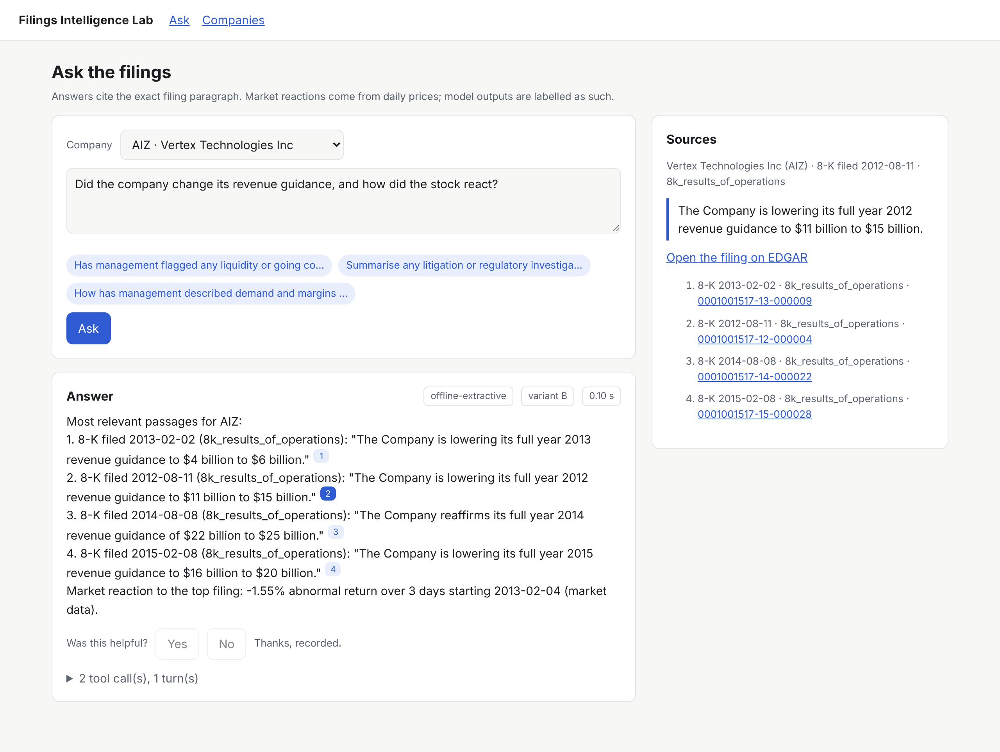
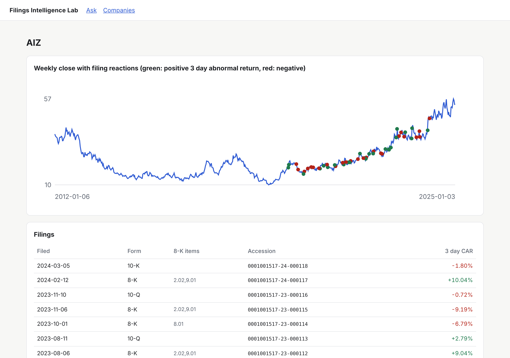
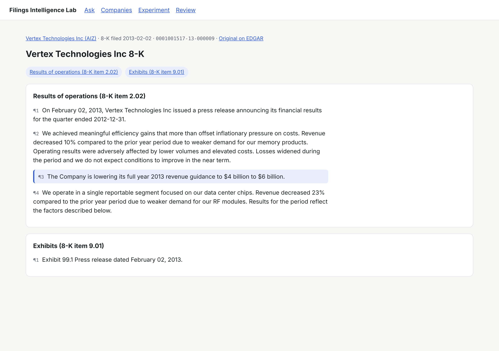
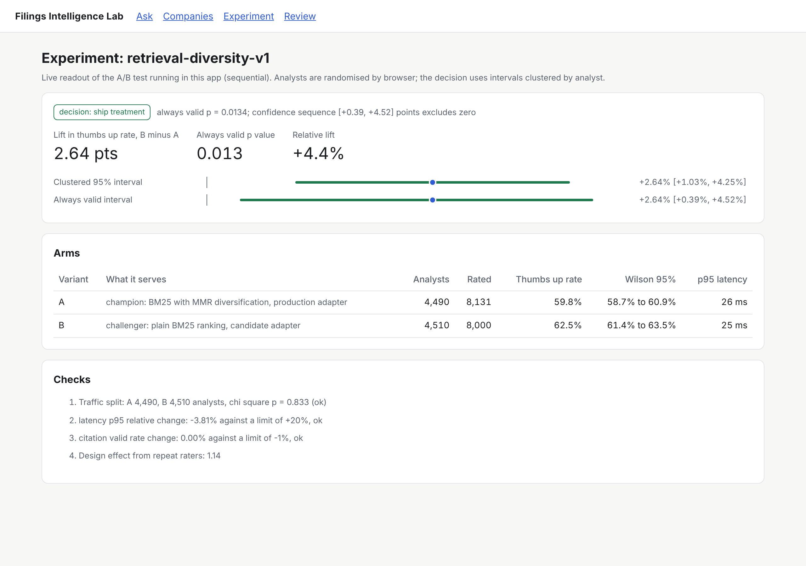
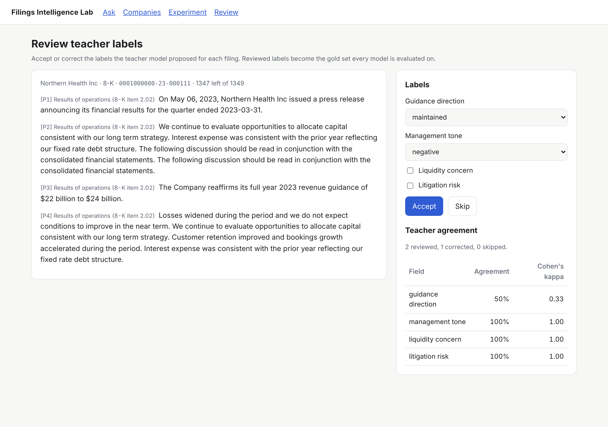

# Phase 5: Analyst agent and app

An analyst asks a question about a company in plain English and gets a short answer in which every
statement drawn from a filing links to the exact paragraph it came from.

## Agent (`filings_lab/agent`)

Tools (strict JSON schemas, `tools.py`):

| Tool | Returns |
|---|---|
| `search_filings(query, ticker, form, date_from, date_to, k)` | best paragraphs with paragraph ids (BM25 with MMR diversification, filters applied before ranking) |
| `get_paragraph(paragraph_id)` | full text, neighbouring paragraph ids, EDGAR URL |
| `list_filings(ticker, form, limit)` | a company's filings with their 3 day abnormal return |
| `get_price_history(ticker, start, end)` | return, drawdown, volatility, weekly closes |
| `get_event_return(accession)` | day 0 return and CAR[0,+2] for one filing |
| `extract_signals(accession)` | runs the extraction model this session serves (its A/B variant's LoRA adapter on vLLM, rules offline) and returns signals with quotes resolved to paragraph ids |
| `get_model_signal(accession)` | stored LLM signals and the reaction model's probability with drivers |

Citation integrity: the tool box records every paragraph id it returns during a request. The validator
accepts a citation only if its id is in that set. If the model cites an id it was never shown, the agent
sends one repair turn listing the bad ids; whatever is still invalid after that is returned flagged, and the
UI shows it with a dashed outline instead of hiding it. `citation_valid_rate` is logged for every answer and
is an A/B guardrail in Phase 6.

Online agent loop (`agent.py`): a hosted frontier model (`FLAB_AGENT_MODEL` sets which), effort high, a cacheable system
prompt, strict tools with automatic tool choice, the full assistant content appended every turn so thinking
blocks replay unchanged, all tool results of a turn returned in one message, explicit handling of
`tool_use`, `pause_turn`, `refusal` and `max_tokens`, server side refusal fallback, a turn cap and token cost
accounting. A scripted fake client tests the loop deterministically (`tests/test_agent.py`).

Offline mode: without an API key the service answers with `ExtractiveAgent`: the same retrieval and tools,
quoting the most relevant sentence of each hit with its citation and the market reaction to the top filing.
The service also falls back to it if the API errors.

## API routes (mounted into the Phase 4 service)

`POST /v1/agent/ask`, `POST /v1/feedback`, `GET /v1/companies`, `GET /v1/companies/{ticker}/filings`,
`GET /v1/companies/{ticker}/prices`, `GET /v1/paragraphs/{id}`, `GET /v1/experiments/current`.

## Frontend (`web/`, Next.js 15, React 19, TypeScript strict)

1. Ask page: company picker, question box with examples, answer with numbered citation chips, a source panel
   that loads the cited paragraph with a link to the filing on EDGAR, feedback buttons, the tool trace, and
   badges for mode, A/B variant, latency and cost.
2. Company page: weekly price chart (dependency free SVG) with filing reactions marked, and the filings
   table with each filing's 3 day abnormal return.
3. Next.js route handlers proxy to the Python API and add the API key on the server, so it never reaches the
   browser. Middleware sets an anonymous `flab_uid` cookie, the unit of randomisation for the A/B test.
4. Checks: `npm run lint`, `npm run typecheck`, `npm test` (vitest: citation parsing and formatting),
   `npm run build`; all run in CI.

4. Filing viewer: every citation opens the filing at the cited paragraph, highlighted, with section
   navigation and a link to the original on EDGAR.
5. Experiment page: the live A/B readout (decision, lift with clustered and always valid intervals, arms,
   traffic split and guardrail checks).
6. Review page: human review of teacher labels with agreement and Cohen's kappa (Phase 3).

Verified end to end in this environment: the API and the Next.js server ran together and a headless browser
asked a question, opened a citation, recorded feedback and loaded a company page with no page errors; the
exposure and the rating landed in the experiment log with the assigned variant.

## Scaling notes

The in memory store and BM25 index suit a few hundred companies. For all of EDGAR: OpenSearch (BM25 plus
a dense vector field) for `search_filings`, warehouse tables for events and prices, and the online feature
store for model outputs; the tool interfaces stay the same.
